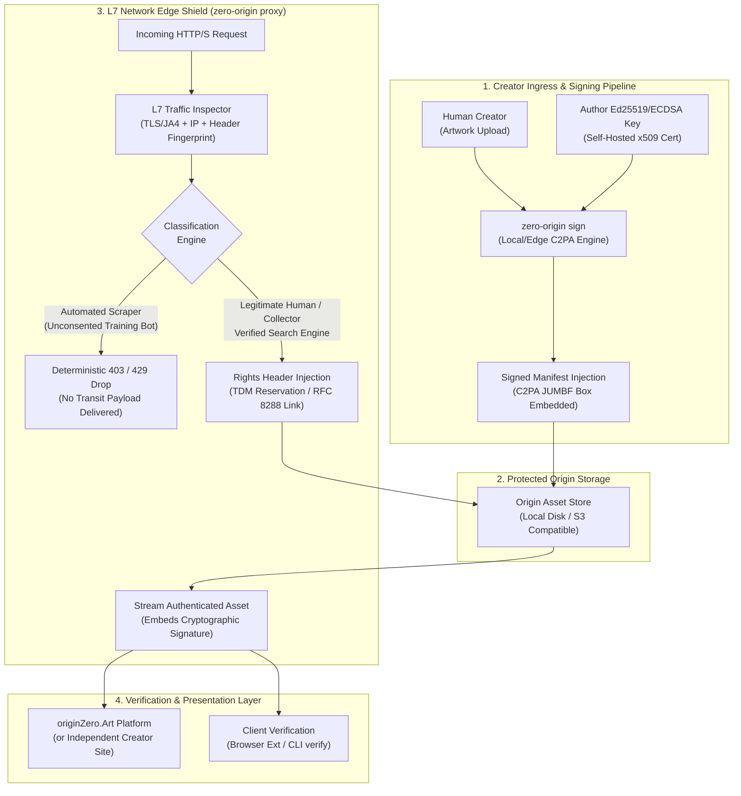

<!--
SPDX-License-Identifier: Apache-2.0
SPDX-FileCopyrightText: 2026 Sebastian Paul Banszky <contact@originzero.art>
-->

# zero-origin

> **Self-Hosted Network Edge Shield and Cryptographic Provenance Daemon for Human Creators**  
> Part of the [originZero.Art](https://originzero.art) Sovereign Infrastructure Ecosystem.

[](LICENSE-AGPLv3)
[](LICENSE-APACHE)
[](#cryptographic-provenance-c2pa)
[](https://originzero.art/commons)

---

## 1. Problem Statement

Independent visual artists, fine-art painters, and visual identity designers face an asymmetric structural challenge:

1. **Unconsented Automated Harvesting:** Autonomous commercial crawler fleets systematically scrape creative portfolios at scale to train proprietary synthetic image models without consent, compensation, or attribution.
2. **Infrastructure Resource Depletion:** High-frequency, distributed scraping bots generate massive I/O load and transit costs on creator hosting environments, frequently masquerading as legitimate user agents.
3. **Loss of Verifiable Provenance:** Once published on the open web, original raster assets are stripped of metadata, re-uploaded, and intermingled with synthetic derivatives, making empirical verification of human authorship impossible without centralized SaaS gatekeepers.
4. **Fragile Opt-Out Conventions:** Existing standard opt-out mechanisms (e.g. `robots.txt`) are routinely ignored by scraping fleets unless actively intercepted and rejected at the transport and application layers.

`zero-origin` solves these challenges by combining **deterministic Layer-7 edge crawler mitigation** with **local, self-hosted C2PA cryptographic provenance signing** and **machine-readable rights enforcement headers**.

---

## 2. System Architecture

`zero-origin` operates either as an inline reverse proxy (protecting existing web servers like Nginx, Caddy, or Apache) or as a standalone asset gateway.



### Architectural Data Flow

1. **Intake & Local Signing:** When a creator publishes a visual asset, `zero-origin` signs the asset locally using the author's private key (Ed25519 or ECDSA P-256), creating a C2PA-compliant manifest containing authorship claims, capture timestamp, and cryptographic hash assertions. No third-party SaaS cloud is consulted.
2. **Edge Inspection:** Incoming HTTP requests pass through the Layer-7 reverse proxy. The traffic inspector evaluates TLS client hello parameters (JA4 fingerprinting), IP reputation blocks, ASN routing flags, and request header anomalies.
3. **Deterministic Crawler Mitigation:** Identified training bots and extractive scrapers are severed with immediate `403 Forbidden` or `429 Too Many Requests` responses, cutting off transit bandwidth before the underlying asset payload is unbuffered.
4. **Rights Assertion Injection:** For legitimate visitors and indexers, `zero-origin` injects machine-readable headers:
   - `Link: <https://originzero.art/license/tdm-reservation>; rel="license"`
   - `X-Robots-Tag: noai, noimageai`
   - `TDM-Reservation: 1` (EU Directive 2019/790 Article 4 compliance)
5. **Human Provenance Integrity:** The served asset retains its embedded C2PA manifest, enabling collectors, galleries, and viewers to empirically verify human origin using any standard C2PA validator.

---

## 3. Component & License Matrix

To ensure maximum ecosystem adoption while strictly preventing proprietary cloud lock-in, `zero-origin` is governed by a dual-license architecture:

| Component | Workspace Path | SPDX License | Architectural Rationale |
| :--- | :--- | :--- | :--- |
| **L7 Reverse Proxy & Audit Engine** | `crates/zero-origin-proxy/`, `crates/zero-origin-cli/` | **AGPL-3.0-or-later** | Network copyleft ensures any service hosting or extending the edge crawler shield must publish modifications to the public commons. |
| **TLS ClientHello JA4 Inspector** | `crates/zero-origin-ja4/` | **AGPL-3.0-or-later** | Non-destructive wire-level JA4 extraction prior to TLS termination. |
| **C2PA Signer & Keygen** | `crates/zero-origin-c2pa/` | **AGPL-3.0-or-later** | Prevents proprietary enclosure of the local cryptographic signing daemon. |
| **Open Rights & Verification Core** | `crates/zero-origin-common/`, `crates/zero-origin-verify/` | **Apache-2.0** | Permissive core allowing third-party galleries and tools to embed C2PA & TDM verification with zero copyleft propagation. |
| **Open Specifications & Schemas** | `specs/`, `schemas/` | **Apache-2.0** | Standardized EU DSM 2019/790 Art. 4 TDM reservations & `ai.txt` schemas. |
| **Multi-Language Client SDKs** | `sdk/typescript/`, `sdk/python/`, `sdk/go/` | **Apache-2.0** | Zero-dependency verifiers for Node.js/TypeScript browsers, Python workflows, and Go services. |
| **Verification & Test Suites** | `scripts/` | **Apache-2.0** | REUSE 3.0 SPDX verification, latency benchmarks, and adversarial test suites. |

---

## 4. Architectural Boundary: Open-Core Protocol vs. Private Artist Subdomains

originZero.Art enforces a strict, unambiguous boundary between public open-source infrastructure and private or managed artist environments:

### 4.1 What IS Open Source (`github.com/originzero-art`)
- **`zero-origin` Standalone Edge Shield:** Reverse-proxy crawler mitigation engine, TLS fingerprinting, and local C2PA cryptographic provenance daemon (**GNU AGPLv3**, with copyright and CLA retained by the founder to permit commercial dual-licensing).
- **Sovereign Creator Licensing Protocol:** Open machine-readable creator autonomy specifications, TDM reservation headers (`ai.txt`, RFC 8288 Link headers), and manifest verification schemas (**Apache License 2.0**).
- **Public Governance & Platform Frontend:** Static web platform code and public documentation for the root domain `originzero.art` (**Apache License 2.0**).

### 4.2 What is STRICTLY PRIVATE & PROPRIETARY (Closed Source)
- **Creator Portfolios & Original Artwork:** 100% exclusive copyright and moral rights to all paintings, illustrations, visual identity marks, logos, and high-resolution assets hosted across the platform are strictly retained by each respective human creator.
- **Dedicated & Leased Artist Subdomains (`*.originzero.art`):** Dedicated artist spaces (such as `757.originzero.art`, `spartan.originzero.art`, `crimadezignz.originzero.art`) and future leased studio subdomains, including bespoke gallery templates, multi-tenant provisioning, billing, and Done-For-You hosting infrastructure, operate independently as closed-source proprietary systems.
- **Decoupled L7 Edge Operation:** `zero-origin` operates strictly as a decoupled Layer-7 edge proxy and provenance signer in front of web origins. Downstream creator websites, bespoke backends, and leased subdomains remain completely independent, modular, and closed-source.

---

## 5. Implemented Rust CLI & Local Verification

`zero-origin` is engineered as a deterministic Rust Cargo workspace (`Cargo.toml`) compiling to a single static binary with embedded SQLite WAL telemetry and pure-Rust TLS/cryptography.

### 5.1 CLI Tooling Interface

```bash
# 1. Generate local self-hosted cryptographic keypair & X.509 cert (0600 permissions)
zero-origin keygen --alg ed25519 --name "Sebastian Paul Banszky" --domain "originzero.art" --out ./keys

# 2. Losslessly embed C2PA/JUMBF manifest without pixel re-encoding (JPEG, PNG, WebP, AVIF)
zero-origin sign \
  --input ./master-canvas.jpg \
  --output ./public/master-canvas.jpg \
  --key ./keys/creator.key.pem \
  --cert ./keys/creator.cert.pem \
  --creator "Sebastian Paul Banszky" \
  --title "Singularity Point"

# 3. Verify embedded cryptographic provenance offline or inspect HTTP/HTTPS TDM headers
zero-origin verify ./public/master-canvas.jpg

# 4. Launch the L7 defensive reverse proxy locally
zero-origin serve --config ./config.example.toml

# 5. Query zero-PII blocked crawler telemetry from embedded SQLite WAL store
zero-origin audit --db ./zero-origin-audit.db
```

### 5.2 Declarative Configuration (`config.example.toml`)

See [`config.example.toml`](config.example.toml) for configuration parameters.

---

## 6. Governance & Institutional Support

`zero-origin` is governed under transparent open-source principles:

- **Fiscal Host:** Transitioning to **Open Collective Europe** (OCE, Brussels) to provide an auditable public ledger for all project income, disbursements, and institutional grant funding.
- **R&D Grants Alignment:** Designed to satisfy technical and procedural requirements for the **NLnet Foundation (NGI Zero Commons Fund)** and the **Mozilla Foundation**.
- **Founding Community Pilot:** Battle-tested across the live [originZero.Art](https://originzero.art) showcase platform with a founding pilot group of 3 human artists.
- **Audited Engineering:** Led by **Sebastian Paul Banszky** ([banszky.men](https://banszky.men)), Senior Network Security & Cloud Architect, operating audited EU engineering operations in Romania.

---

## 7. Security Disclosures

To report edge-shield bypass vectors, TLS fingerprint impersonation techniques, or manifest forgery vulnerabilities, please send an encrypted report to [contact@originzero.art](mailto:contact@originzero.art). See [SECURITY.md](SECURITY.md) for full PGP details.

---

## 8. Licenses

- The `zero-origin` daemon, reverse-proxy engine, and signing core are licensed under the **[GNU Affero General Public License v3.0](LICENSE-AGPLv3)**.
- The open specifications, TDM schemas, client libraries, and documentation are licensed under the **[Apache License 2.0](LICENSE-APACHE)**.
